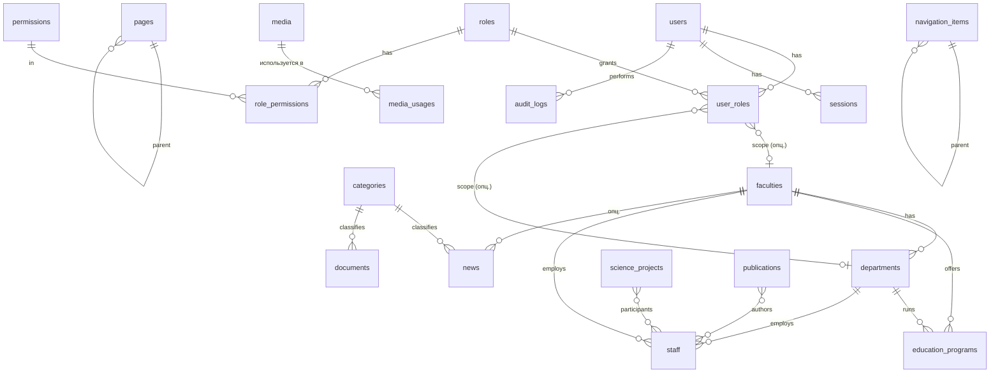

# BSU Backend — архитектура (черновик v0.1)

> Статус: **проект на согласование** с frontend- и backend-разработчиками.
> Ветка: `feature/backend`. Код backend живёт в `backend/` этого репозитория.
> Ничего из описанного ниже ещё не развёрнуто; тестового URL пока нет.

## 1. Итоги аудита frontend (19.11.2026)

| Источник | Что содержит | Как переносим |
|---|---|---|
| `src/lib/archive-data/*.json` (1000 файлов, 7,5 МБ) | `{title, lang, blocks[], variants[]}`; блоки `text` / `bullet` / `heading` / `image` / `table`; языки `ru` (330), `en` (229), `ky` (227), `cn` (214) | `pages` / `news` + переводы; блоки → `content_blocks` (JSONB); `cn` → `zh-CN` |
| `src/lib/archive-index.ts` (381 запись) | id, href, язык, варианты; 273 новости, 108 страниц по 15 разделам | определяет тип записи (news/page) и раздел по `href` |
| `faculty-data.ts`, `department-data.ts`, `staff-data.ts`, `program-data.ts` | Типизированные записи (`FacultyRecord`, `DepartmentRecord`, `StaffRecord`, `ProgramRecord`) только на ru | `faculties`, `departments`, `staff`, `education_programs`; переводы помечаются отсутствующими |
| `news-data.ts`, `document-data.ts`, `science-data.ts` | Новости, документы (пока ссылки на bsu.kg), разделы науки | `news`, `documents`, `science_*` |
| `partners-carousel-data.ts` | Партнёры с `names` на 4 языках (уже `zh-CN`) | `partners` + переводы |
| `library-books.ts` | Пусто (`localBooks = []`) | `library_books`, наполняет библиотека |
| `pages-data.ts`, `site-registry.ts` | `LocalText = Record<Locale,string>`, реестр маршрутов | `pages`, `navigation` |
| `src/app/admin`, `AdminWorkspace.tsx` | Клиентский прототип без авторизации | заменяется вызовами `/api/v1/admin/*` |
| `src/lib/api/faculties.ts` | Адаптер-заглушка, ждёт `GET /api/v1/faculties[/{slug}]` | первая точка интеграции |

Правило: **факты (имена, телефоны, должности) переносим как есть, с `source_url`**; ничего не досочиняем. Записи из архива импортируются со статусом `draft` или `published` по решению редакции.

## 2. Стек

| Слой | Выбор | Почему |
|---|---|---|
| API | **FastAPI** + Uvicorn (Gunicorn-воркеры в проде) | OpenAPI/Swagger из коробки, Pydantic-валидация, async |
| ORM / миграции | SQLAlchemy 2 (async) + **Alembic** | Зрелые, параметризованные запросы → защита от SQL-инъекций |
| БД | **PostgreSQL 16** | JSONB для блоков, полнотекстовый поиск, `pg_trgm` |
| Файлы | Локальный том в dev, **S3-совместимое хранилище** (MinIO / облако) в проде | Не храним файлы в БД и в `public/` |
| Кеш | HTTP-кеш (`Cache-Control`, `ETag`) + кеш Next.js; **Redis — опционально** | Redis нужен только при нескольких инстансах API (rate limit, кеш) |
| Пароли | Argon2id | Современный стандарт |
| Тесты | pytest + httpx; нагрузка — k6 или Locust | |
| Линт | ruff | |

## 3. Структура кода

```
backend/
  app/
    main.py            # создание приложения, middleware, роутеры
    core/              # config, errors, i18n, security, pagination
    db/                # engine/session, базовая модель
    models/            # SQLAlchemy-модели
    schemas/           # Pydantic-схемы запросов/ответов
    api/v1/            # роутеры: public/*, admin/*, auth
    services/          # бизнес-логика (публикация, поиск, медиа)
  alembic/             # миграции
  scripts/             # импорт данных frontend
  tests/
```

## 4. Мультиязычность

- Канонические коды: `ru`, `ky`, `en`, `zh-CN`. Входные синонимы нормализуются: `cn`, `zh`, `zh-cn` → `zh-CN`; `kg`, `kgz` → `ky`; `rus` → `ru`.
- Язык запроса: параметр `?lang=` → заголовок `Accept-Language` → `ru` по умолчанию.
- Хранение: у каждой переводимой сущности есть таблица `<entity>_translations (entity_id, locale, …поля, status, updated_at)`, PK `(entity_id, locale)`.
  Так каждый язык можно редактировать, публиковать и искать отдельно.
- Ответ всегда сообщает, какой язык отдан и какие есть:
  ```json
  { "lang": "ky", "requested_lang": "ky", "is_fallback": false,
    "available_langs": ["ru", "ky", "en"], "missing_langs": ["zh-CN"], ... }
  ```
  Если перевода нет, отдаётся `ru` с `is_fallback: true` (frontend решает, показать ли пометку).

## 5. Модель данных (ER)



Основные таблицы (у переводимых есть `*_translations`):

| Группа | Таблицы | Ключевые поля |
|---|---|---|
| Доступ | `users`, `roles`, `permissions`, `role_permissions`, `user_roles(user_id, role_id, faculty_id?, department_id?)`, `sessions` | `permissions.code` вида `news:publish`; scope ограничивает роль факультетом/кафедрой |
| Структура | `faculties`, `departments`, `staff`, `education_programs` | `slug` (unique), `kind`, `level`, `code`, контакты, `source_url`, `sort_order` |
| Контент | `news`, `categories`, `documents`, `pages`, `content_blocks` | `status (draft/review/published/archived)`, `published_at`, `blocks JSONB`, `legacy_id` |
| Разделы | `partners`, `library_books`, `admissions_*` (кампании, требования, FAQ), `science_projects`, `publications` | |
| Сервис | `media`, `media_usages`, `navigation_items`, `site_settings (key, value JSONB)`, `redirects (from_path, to_path, code)`, `audit_logs` | `audit_logs`: кто, когда, что, `before`/`after` JSONB, IP |

Общие поля: `id` (bigint identity), `created_at`, `updated_at`, `created_by`, `updated_by`, `deleted_at` (мягкое удаление), `version` (оптимистичная блокировка → ETag).

Индексы: unique `slug`; `(status, published_at DESC)` для лент; FK-индексы; GIN по `tsvector` в `*_translations` (конфигурации `russian`, `english`, `simple` для ky/zh-CN) и `pg_trgm` по заголовкам.

`legacy_id` хранит id из архива (`006fc3858f81`) — по нему импорт идемпотентен и строятся редиректы со старых URL.

## 6. API

Префикс `/api/v1`. Документация: `/api/docs` (Swagger UI), `/api/openapi.json`.

### Публичное (только `published`, только GET)

| Ресурс | Эндпоинты |
|---|---|
| Факультеты | `GET /faculties`, `GET /faculties/{slug}` |
| Кафедры | `GET /departments?faculty=`, `GET /departments/{slug}` |
| Сотрудники | `GET /staff?q=&faculty=&department=`, `GET /staff/{slug}` |
| Программы | `GET /programs?level=&faculty=&q=`, `GET /programs/{slug}` |
| Новости | `GET /news?category=&faculty=&q=&from=&to=`, `GET /news/{slug}` |
| Документы | `GET /documents?category=&q=`, `GET /documents/{slug}` |
| Страницы | `GET /pages/{path}` (иерархический путь) |
| Партнёры | `GET /partners?group=` |
| Библиотека | `GET /library/books?q=&author=` |
| Абитуриентам | `GET /admissions/campaigns`, `/requirements`, `/faqs`, `/contacts` |
| Наука | `GET /science/projects`, `/science/publications`, `/science/pages/{slug}` |
| Навигация | `GET /navigation?menu=main` |
| Поиск | `GET /search?q=&type=&lang=` |
| Настройки | `GET /site-settings` (только публичные ключи) |
| Редиректы | `GET /redirects?path=` (для middleware Next.js) |

### Авторизация

`POST /auth/login`, `POST /auth/refresh`, `POST /auth/logout`, `GET /auth/me`, `POST /auth/password`.

### Админское (`/admin`, только с авторизацией и проверкой прав)

Для каждого ресурса (`faculties`, `departments`, `staff`, `programs`, `news`, `categories`, `documents`, `pages`, `partners`, `library`, `admissions`, `science`, `navigation`, `site-settings`, `redirects`):

- `GET /admin/{resource}?status=&q=&page=` — список, включая черновики
- `POST /admin/{resource}` — создать черновик
- `GET|PATCH|DELETE /admin/{resource}/{id}` — `PATCH` требует `If-Match` (версия); `DELETE` — мягкое удаление
- `PUT /admin/{resource}/{id}/translations/{lang}` — перевод отдельно
- `POST /admin/{resource}/{id}/publish`, `/unpublish`
- `GET /admin/{resource}/{id}/history` — из `audit_logs`

Плюс `POST /admin/media` (загрузка), `GET /admin/media`, `/admin/users`, `/admin/roles`, `/admin/audit-logs`.

### Общие соглашения

- Пагинация: `?page=1&limit=20` (max 100) → `{ "items": [], "page": 1, "limit": 20, "total": 0, "pages": 0 }`.
- Сортировка: `?sort=-published_at`.
- Даты — ISO 8601 UTC.
- Ошибки — единый формат:
  ```json
  { "error": { "code": "not_found", "message": "Resource not found", "details": null, "request_id": "…" } }
  ```

| HTTP | `code` | Когда |
|---|---|---|
| 400 | `bad_request` | Некорректный запрос |
| 401 | `unauthorized` | Нет/истекла сессия |
| 403 | `forbidden` | Нет права или вне scope |
| 403 | `csrf_failed` | Нет/неверный CSRF-токен |
| 404 | `not_found` | Нет записи или она не опубликована |
| 409 | `conflict` | Дубликат slug |
| 412 | `precondition_failed` | Версия (`If-Match`) устарела |
| 413 | `payload_too_large` | Файл больше лимита |
| 415 | `unsupported_media_type` | Запрещённый тип файла |
| 422 | `validation_error` | Ошибка валидации полей (`details` — список полей) |
| 429 | `rate_limited` | Превышен лимит запросов |
| 500 | `internal_error` | Внутренняя ошибка (детали только в логах) |
| 503 | `service_unavailable` | БД недоступна |

## 7. Авторизация и права

- Логин/пароль (Argon2id) → **access-токен (15 мин)** и **refresh-токен (14 дней, ротация)** в cookie `HttpOnly; Secure; SameSite=Lax`. Refresh хранится в `sessions` в виде хеша; повторное использование старого refresh отзывает всю сессию.
- Админка и API должны быть **на одном сайте** (например, `bsu.kg` и `api.bsu.kg`), тогда `SameSite=Lax` работает.
- CSRF: double-submit — cookie `csrf_token` + заголовок `X-CSRF-Token` на всех изменяющих запросах.
- Права: `permissions.code` (`news:create`, `news:publish`, `users:manage`, …). Роль может быть ограничена факультетом/кафедрой; проверка — в зависимости FastAPI на каждом эндпоинте **и** в запросе к БД (фильтр по scope).
- Стартовые роли (настраиваемые): `superadmin`, `admin`, `editor` (все разделы, без публикации), `publisher`, `faculty_editor` (только свой факультет), `translator` (только переводы).
- Блокировка после N неудачных входов, лимит на `/auth/login`. 2FA (TOTP) — второй этап.

## 8. Безопасность

- SQL-инъекции: только ORM/параметризованные запросы.
- XSS: блоки контента хранятся структурно (JSON), а не HTML; если появится rich text — санитизация на сервере (`nh3`) по белому списку тегов.
- CORS: только явный список origin из `.env` (`CORS_ORIGINS`).
- Rate limiting: общий и строгий для `/auth/*`; в памяти на одном инстансе, через Redis — при нескольких.
- Загрузка файлов: белый список (JPEG/PNG/WebP/PDF/DOCX/XLSX), проверка по сигнатуре, лимиты размера, случайные имена, изображения перекодируются (удаляются EXIF), генерируются WebP-варианты; опционально ClamAV.
- Заголовки: HSTS, `X-Content-Type-Options`, `Referrer-Policy`, `X-Frame-Options`.
- Секреты только в переменных окружения, в репозитории — `.env.example` без значений.
- Логи: структурированные JSON, `request_id` в каждом ответе; ошибки — в Sentry или аналог (по согласованию).
- Резервные копии: ежедневный `pg_dump` + хранение 30 дней, бэкап хранилища файлов; ежемесячная проверка восстановления.

## 9. Производительность (цель — 1000 одновременных пользователей)

- Основная нагрузка — публичные GET. Next.js кеширует ответы (Cache Components / `revalidateTag`), backend отдаёт `Cache-Control: public, max-age=60, stale-while-revalidate=600` и `ETag`.
- При публикации backend вызывает webhook ревалидации Next.js (`POST /api/revalidate` с секретом) — изменения видны сразу без нагрузки на API.
- Пул соединений к БД, индексы под каждый фильтр, пагинация без больших `OFFSET` в лентах (keyset для новостей при необходимости).
- Цель для API под нагрузкой 1000 VU (k6): p95 < 300 мс на списках, ошибок < 1 %. **Подтверждается только нагрузочным тестом на тестовом сервере.**

## 10. Развёртывание

- Frontend: Vercel (как сейчас).
- Backend: Docker-образ на VPS/облаке (решить с университетом), за Nginx/Caddy с TLS; PostgreSQL — управляемый или на том же сервере с бэкапами.
- Окружения: `local` (Docker Compose), `staging` (тестовый URL), `production`.

## 11. План работ

| # | Этап | Статус |
|---|---|---|
| 1 | Аудит frontend, архитектура (этот документ) | ✅ черновик |
| 2 | Каркас: FastAPI, конфигурация, ошибки, i18n, health, Docker Compose, Alembic, тесты | ✅ |
| 3 | Модели и миграции всех таблиц | ⏳ |
| 4 | Авторизация, роли, права, аудит | ⏳ |
| 5 | Публичное API, поиск, фильтры | ⏳ |
| 6 | Импорт данных frontend | ⏳ |
| 7 | Админское API, медиа | ⏳ |
| 8 | Тестовый сервер, подключение frontend | ⏳ |
| 9 | Интеграционные и нагрузочные тесты | ⏳ |

## 12. Открытые вопросы к команде/университету

1. Где будет размещён backend и кто его администрирует?
2. Домен API (`api.bsu.kg`?) — нужен для cookie и CORS.
3. Нужен ли вход через университетские учётные записи (SSO / Google Workspace)?
4. Кто утверждает публикацию: один редактор или двухэтапно (редактор → публикатор)?
5. Какие архивные материалы публиковать сразу, а какие оставить черновиками до проверки?
6. Хранилище файлов: облачное S3 или диск сервера?
